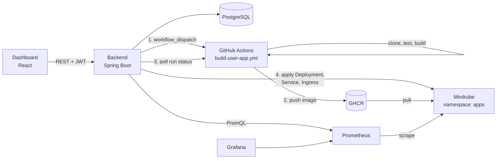

# DeployHub

A small, educational Platform-as-a-Service. Point it at a GitHub repository and it builds and tests the code with GitHub Actions, packages it as a Docker image in GitHub Container Registry, runs it on Kubernetes, and shows its health and metrics on a dashboard.



## How a deployment works

| State | What is happening | Who does it |
|---|---|---|
| `QUEUED` | Deployment record created, image name decided (`ghcr.io/<owner>/deployhub-apps:<app>-d<id>`) | Backend |
| `BUILDING` | Workflow clones the repo, runs the tests, builds and pushes the image | GitHub Actions |
| `IMAGE_PUSHED` | Backend saw the run succeed | Backend (polls every 5 s) |
| `DEPLOYING` | Deployment, Service and Ingress applied; Kubernetes rolls out new pods one at a time | Kubernetes |
| `RUNNING` | All pods are on the new image and ready | Backend marks the previous one `SUPERSEDED` |
| `BUILD_FAILED` / `DEPLOY_FAILED` | Tests failed, image wouldn't pull, app crashed, or a timeout | The old version keeps serving |

There are two pipelines. Keep them apart in your report:

1. **`build-user-app.yml`** builds *users'* apps on request from the backend.
2. **`platform-ci.yml`** tests and builds *DeployHub's own* code on every push and pull request.

## Changes from the original plan (and why)

| Change | Why it makes the project easier |
|---|---|
| Backend and frontend run on your laptop during development; only user apps run in Minikube. Running the whole platform in-cluster is an optional extra script. | Fewer moving parts. You can restart the backend in seconds. |
| GitHub Actions builds, the backend deploys. No webhooks. | GitHub's runners can't reach a cluster on your laptop. Polling avoids ngrok entirely. |
| All user apps go into **one** GHCR package (`deployhub-apps`), one tag per deployment. | One pull secret, or one "make public" click, covers every app. |
| New **Folder** field on an app. | The sample apps live in this repo. You can demo without creating extra repositories. |
| The dashboard polls every few seconds instead of using WebSockets. | Much less code, and it looks identical in a demo. |
| Grafana is linked, not embedded. Basic charts are drawn by the dashboard from Prometheus. | Embedding Grafana needs extra auth configuration. |
| The Spring Boot scrape config lives in the Helm values (`additionalServiceMonitors`). | Avoids Terraform failing to plan a CRD that doesn't exist yet. |
| **Rollback** and **pod logs** included. | Both were "future enhancements" but cost very little. Rollback reuses an old image tag. |

## Repository layout

```
backend/        Spring Boot API: auth, apps, deployments, Kubernetes + GitHub + Prometheus clients
frontend/       React (Vite) dashboard
builder/        Dockerfile templates per runtime + the test runner used by the build workflow
sample-apps/    hello-spring, hello-node, hello-flask: ready-made apps to deploy in the demo
terraform/      Namespaces, quotas, pull secret, RBAC, Prometheus + Grafana (Helm), Grafana dashboard
monitoring/     Grafana dashboard JSON (loaded automatically by Terraform)
k8s/platform/   Optional: run DeployHub itself inside the cluster
scripts/        One-command helpers for setup, running and the demo
.github/        The two pipelines
```

## Team ownership

| Member | Owns |
|---|---|
| 1 | `frontend/` |
| 2 | `backend/` (`web/`, `service/`, `domain/`, `config/`, DB migrations) |
| 3 | `builder/`, `.github/workflows/build-user-app.yml`, `backend/.../github/`, `sample-apps/` |
| 4 | `terraform/`, `k8s/`, `backend/.../k8s/` |
| 5 | `.github/workflows/platform-ci.yml`, `monitoring/`, `backend/.../metrics/`, testing |

---

## Setup

### Prerequisites

Docker, Minikube, kubectl, Terraform 1.5+, Java 17+, Maven, Node.js 20+, and a GitHub account. Minikube needs about 4 CPUs and 8 GB of RAM for the monitoring stack, so use the strongest laptop in the team as the demo machine.

### 1. Put the code on GitHub

Create a **public** repository named `deployhub` and push this folder to its `main` branch. The workflow file must be on the default branch before the API can trigger it. Public repos also get free Actions minutes.

### 2. Create two tokens

**A. For the backend to start builds:** a *fine-grained* personal access token.

- Repository access: only `deployhub`.
- Permissions: **Actions → Read and write**.

**B. For Kubernetes to pull images:** a *classic* token with only the `read:packages` scope. GHCR pulls use classic tokens.

You can skip token B by making the `deployhub-apps` package public after your first build. See "Without a pull secret" under troubleshooting.

### 3. Create the cluster

```bash
cp terraform/terraform.tfvars.example terraform/terraform.tfvars   # put token B and your username in it
scripts/setup-cluster.sh
```

This starts Minikube, enables the ingress and metrics-server add-ons, and runs `terraform apply`. Terraform creates the namespaces, quotas, pull secret, RBAC, and the Prometheus + Grafana stack. The first run takes a few minutes. At the end it prints the `APP_DOMAIN` to use.

On **macOS or Windows**, keep `minikube tunnel` running in its own terminal. Without it, the app URLs won't open.

### 4. Configure and start the backend

```bash
cp backend/.env.example backend/.env    # fill in token A, GITHUB_OWNER, JWT_SECRET, APP_DOMAIN
scripts/port-forward.sh                 # terminal 2: Prometheus :9090, Grafana :3000
scripts/run-backend.sh                  # terminal 3: Postgres via Docker + API on :8080
scripts/run-frontend.sh                 # terminal 4: dashboard on http://localhost:5173
```

### 5. Deploy the sample app

In the dashboard, create an account, then click **New app** and fill in:

| Field | Value |
|---|---|
| Repository URL | `https://github.com/<you>/deployhub` |
| Branch | `main` |
| Folder | `sample-apps/hello-spring` |
| Runtime | Spring Boot |
| Name | `hello-spring` |
| Health check path | `/actuator/health` |

Then click **Create and deploy**. The first build takes 2–4 minutes; later ones are faster thanks to caching.

---

## Demo script

1. **Register and deploy.** Create `hello-spring` as above. While it builds, open the workflow run from the "GitHub Actions run" link and show the test, build and push steps.
2. **It's live.** The pipeline line reaches *Live*. Open the URL; the JSON shows which pod answered.
3. **Scale.** Click **+** twice to get 3 replicas. Pods appear, and refreshing the app URL shows different pod names (load balancing). The *Pods available* chart and Grafana follow.
4. **Self-healing.** Click **Delete** on a pod. It shows as terminating and a replacement appears within seconds.
5. **Rolling update with zero downtime.** In a terminal, run `scripts/curl-loop.sh http://hello-spring.<APP_DOMAIN>`. Change `VERSION` in `sample-apps/hello-spring/.../HelloController.java` to `"v2"`, push, and click **Deploy latest commit**. The loop switches from v1 to v2 with only `200` responses, because the Deployment uses `maxUnavailable: 0`.
6. **Rollback.** In History, click **Roll back to this** on the previous version. There's no build; the old image is redeployed.
7. **Infrastructure as Code.** Show `terraform/` and `terraform plan` reporting no changes. Then show the Grafana dashboard "DeployHub apps" it created.
8. **Failure handling (optional).** Deploy a branch with a failing test. The build stops at *Build and test*, and the live version keeps running.

Before the demo, do one full warm-up deploy, so images and caches are hot, and record a backup video.

---

## Troubleshooting

| Symptom | Fix |
|---|---|
| "Workflow not found (404)" | `GITHUB_OWNER`/`GITHUB_REPO` are wrong, or `build-user-app.yml` isn't on the default branch yet. |
| "token lacks permission (403)" | Token A needs **Actions: Read and write** on the `deployhub` repo. |
| Rollout fails with `ImagePullBackOff` | The `ghcr-pull` secret is missing or wrong. Re-run `terraform apply` with token B, or make the package public (next row). |
| Without a pull secret | After the first build, open your GitHub profile → Packages → `deployhub-apps` → Package settings → Change visibility → Public. Then set `PULL_SECRET=` (empty) in `backend/.env`. |
| App URL doesn't open | Linux: `APP_DOMAIN` must be `$(minikube ip).nip.io`. macOS/Windows: `minikube tunnel` must be running and `APP_DOMAIN=127.0.0.1.nip.io`. |
| Metrics say Prometheus is unreachable | Run `scripts/port-forward.sh` and leave it open. Check `kubectl -n monitoring get svc` shows `kps-prometheus`. |
| Spring Boot pod restarts while starting | The startup probe allows 150 s. If the laptop is very slow, give Minikube more CPU. |
| `CrashLoopBackOff` for your own app | It must listen on the port you entered, on `0.0.0.0` (not `localhost`). Check **Logs** on the pod. |

## API reference

All endpoints except `/api/auth/*` need `Authorization: Bearer <token>`. Errors come back as `{"error": "..."}`.

| Method | Path | Purpose |
|---|---|---|
| POST | `/api/auth/register`, `/api/auth/login` | Get a JWT |
| GET / POST | `/api/apps` | List / create apps |
| GET / DELETE | `/api/apps/{id}` | App detail / delete app and its Kubernetes resources |
| POST | `/api/apps/{id}/deploy` | Build and deploy the configured branch |
| GET | `/api/apps/{id}/deployments` | History |
| POST | `/api/apps/{id}/deployments/{depId}/rollback` | Redeploy an earlier image |
| GET | `/api/apps/{id}/status` | Live replicas and pods from Kubernetes |
| PATCH | `/api/apps/{id}/scale` | `{"replicas": n}` (0–5) |
| DELETE | `/api/apps/{id}/pods/{pod}` | Delete a pod (self-healing demo) |
| GET | `/api/apps/{id}/pods/{pod}/logs?tail=200` | Pod logs |
| GET | `/api/apps/{id}/metrics?minutes=15` | CPU, memory, pods, request rate |
| GET | `/api/config` | Grafana URL, app domain, whether GitHub is configured |

## Verification status

What has been checked:

- The frontend builds, and every screen was rendered against a mock API.
- The Node and Flask sample tests pass.
- Both workflows pass `actionlint`, including shellcheck.
- `k8s/platform` passes `kubeconform`.
- All Java files parse.

Still to verify on a real machine (see `CLAUDE.md`):

- `mvn verify` for the backend and the Spring sample.
- `terraform validate`.
- A first end-to-end deploy.

Items to confirm during that run, not assume:

- The fabric8 server-side-apply call chain in `KubernetesService.apply`.
- That the GitHub runs API exposes `run-name` as `display_title`.
- The service names `kps-prometheus` and `kps-grafana` created by the Helm chart.
